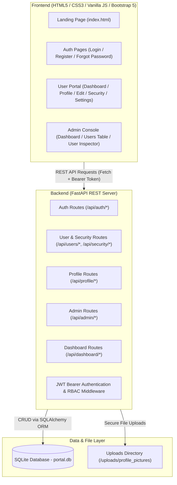

# User Profile Management Portal

A full-stack web application designed for digital profile management and administrative oversight. Built using **FastAPI (Python)** on the backend, **SQLAlchemy ORM** with **SQLite** for relational database management, and modern **HTML5, CSS3, JavaScript (ES6+), and Bootstrap 5** on the frontend.

---

## 📑 Table of Contents
- [Project Overview](#project-overview)
- [Key Features](#key-features)
- [Technology Stack](#technology-stack)
- [System Architecture](#system-architecture)
- [Project Structure](#project-structure)
- [Database Schema](#database-schema)
- [REST API Endpoints](#rest-api-endpoints)
- [Installation & Setup](#installation--setup)
- [Demo Credentials](#demo-credentials)
- [Security Features](#security-features)
- [Future Enhancements](#future-enhancements)

---

## 🌟 Project Overview

The **User Profile Management Portal** provides a centralized system where users can register, authenticate securely, build and manage their personal and address profiles, upload custom profile pictures, update security passwords, and track real-time profile completion.

An **Admin Panel** allows administrators to monitor platform metrics, search and filter users dynamically, manage permissions, edit records, toggle account statuses (ACTIVE / INACTIVE), and perform permanent account deletions.

---

## ✨ Key Features

### 👤 Public & User Features
1. **Interactive Landing Page**: Modern SaaS design with hero section, live feature cards, security details, and demo access points.
2. **User Registration**: Multi-field validation, username/email uniqueness check, interactive password strength meter, requirements checklist, and avatar preview.
3. **Secure Login**: JWT Bearer token authentication with password comparison and "Remember Me" session persistence.
4. **Dynamic User Dashboard**: Personalized welcome card, profile completion percentage bar with action suggestions, last login time, and quick action shortcuts.
5. **My Profile View**: Card-based presentation of personal, address, and account metadata.
6. **Edit Profile**: Full profile updates with instant profile picture upload (supports JPG, PNG, WEBP with 5MB validation).
7. **Security & Password Management**: Current password verification, policy enforcement, and Bcrypt hashing.
8. **Forgot Password Workflow**: Local token generation and secure password reset flow.
9. **Account Settings & Deletion**: Email updates, notification preference toggles, and confirmed account deletion.

### 🛡️ Administrator Features
1. **Admin Authentication**: Dedicated admin login flow with role-based validation (`role == ADMIN`).
2. **Admin Dashboard**: System metrics (Total Users, Active, Inactive, Admin, Monthly Registrations), registration growth trend charts, and account status ratio.
3. **User Management Directory**: Searchable, filterable (by role & status), sortable, and paginated user directory.
4. **User Inspector & Full Profile View**: Comprehensive view of all personal, contact, address, and audit fields.
5. **Account Activation / Deactivation**: Toggle account status instantly without losing user data.
6. **User Editing & Deletion**: Modal-based editing and confirmed user deletion with cascade avatar cleanup.

---

## 🛠 Technology Stack

### Frontend:
- **HTML5 & CSS3**: Semantic elements, custom variables, responsive flexbox & CSS grid.
- **JavaScript (ES6+)**: Fetch API, token management, dynamic DOM manipulation, debounced search.
- **Bootstrap 5**: Responsive layout grid, modals, responsive navbar.
- **Font Awesome 6**: UI icons.
- **Chart.js**: Admin dashboard analytics and charts.

### Backend:
- **Python 3.10+ / 3.14**: High-performance backend runtime.
- **FastAPI**: Modern, asynchronous REST API framework with automatic OpenAPI/Swagger documentation.
- **Uvicorn**: Lightning-fast ASGI web server implementation.
- **Pydantic v2**: Request/response data validation and schema serialization.

### Database & ORM:
- **SQLite**: Local relational database engine.
- **SQLAlchemy 2.0**: Object Relational Mapper for database queries, indexing, and migrations.

### Security:
- **Bcrypt**: Salted password hashing.
- **PyJWT**: JSON Web Token creation and decoding.
- **Python-Multipart**: Form data and file upload handling.

---

## 📐 System Architecture



---

## 📁 Project Structure

```
user-profile-management-portal/
│
├── backend/
│   ├── app/
│   │   ├── __init__.py
│   │   ├── main.py              # FastAPI app initialization, CORS, static routes, startup seed
│   │   ├── database.py          # SQLAlchemy engine, session maker, DB dependency
│   │   ├── models.py            # User SQLAlchemy database model
│   │   ├── schemas.py           # Pydantic validation schemas
│   │   ├── security.py          # Bcrypt hashing & JWT token handling
│   │   ├── auth.py              # Authentication helpers
│   │   ├── dependencies.py      # get_current_user & get_current_admin_user dependencies
│   │   │
│   │   ├── routes/
│   │   │   ├── auth_routes.py       # Register, login, logout, password recovery
│   │   │   ├── user_routes.py       # User profile details, deletion, change password
│   │   │   ├── profile_routes.py    # Profile details and photo upload
│   │   │   ├── admin_routes.py      # Admin user management, search, status, deletion
│   │   │   └── dashboard_routes.py  # User & Admin dashboard stats
│   │   │
│   │   └── services/
│   │       ├── user_service.py      # DB operations for users and admin queries
│   │       ├── auth_service.py      # Authentication and password reset services
│   │       └── profile_service.py   # Upload handling and file verification
│   │
│   ├── uploads/
│   │   └── profile_pictures/    # Stored user profile pictures
│   │
│   ├── seed_data.py             # Database seed script for initial testing data
│   ├── requirements.txt         # Backend Python dependencies
│   └── portal.db                # SQLite database file (created automatically)
│
├── frontend/
│   ├── index.html               # Public Landing Page
│   ├── login.html               # User Login
│   ├── register.html            # User Registration with photo preview & strength meter
│   ├── dashboard.html           # User Overview Dashboard
│   ├── profile.html             # Full Profile Card View
│   ├── edit-profile.html        # Profile Edit Form & Photo Upload
│   ├── security.html            # Password Change & Security Policy
│   ├── settings.html            # Preferences & Confirmed Account Deletion
│   ├── forgot-password.html     # Password Reset Flow
│   │
│   ├── admin/
│   │   ├── admin-login.html     # Admin Console Authentication
│   │   ├── admin-dashboard.html # Platform Metrics & Analytics
│   │   ├── users.html           # User Directory (Search, Filter, Paginate, CRUD)
│   │   └── user-details.html    # Admin User Inspector
│   │
│   ├── css/
│   │   ├── style.css            # Master Design System, Toasts, Badges, Base layout
│   │   ├── auth.css             # Auth cards, password meter, avatar upload boxes
│   │   ├── dashboard.css        # Dashboard sidebar, completion progress, profile cards
│   │   └── admin.css            # Data tables, filter toolbar, pagination, admin modals
│   │
│   ├── js/
│   │   ├── api.js               # Central API Client, JWT auth headers, toast notifications
│   │   ├── auth.js              # Login, register, password meter, forgot-password logic
│   │   ├── dashboard.js         # User dashboard metrics & completion widget
│   │   ├── profile.js           # Profile view and edit form handlers
│   │   ├── security.js          # Password change submission
│   │   ├── settings.js          # Account settings & deletion confirmation
│   │   └── admin.js             # Admin dashboard charts, table management, CRUD modals
│   │
│   └── assets/                  # Static assets
│
└── README.md                    # Complete project documentation
```

---

## 🗄 Database Schema

**Table: `users`**

| Column | Type | Constraints | Description |
| :--- | :--- | :--- | :--- |
| `id` | Integer | Primary Key, Autoincrement | Unique User ID |
| `full_name` | String(150) | Not Null | User's full name |
| `username` | String(50) | Unique, Indexed, Not Null | Unique login handle |
| `email` | String(150) | Unique, Indexed, Not Null | Registered email address |
| `phone` | String(25) | Nullable | Contact phone number |
| `date_of_birth` | String(20) | Nullable | Birth date |
| `gender` | String(20) | Nullable | Gender identity |
| `address` | Text | Nullable | Street address |
| `city` | String(100) | Nullable | City |
| `state` | String(100) | Nullable | State / Province |
| `country` | String(100) | Nullable | Country |
| `postal_code` | String(20) | Nullable | Postal / Zip code |
| `profile_picture`| String(255) | Nullable | Stored image URL path |
| `password_hash` | String(255) | Not Null | Bcrypt hashed password |
| `role` | String(20) | Indexed, Default: "USER" | `USER` or `ADMIN` |
| `status` | String(20) | Indexed, Default: "ACTIVE" | `ACTIVE` or `INACTIVE` |
| `created_at` | DateTime | Indexed, Default: UTC Now | Account creation timestamp |
| `updated_at` | DateTime | Default: UTC Now | Last profile modification |
| `last_login` | DateTime | Nullable | Last successful login |
| `reset_token` | String(255) | Nullable | Password reset token |
| `reset_token_expiry`| DateTime| Nullable | Expiration of reset token |

---

## 🔌 REST API Endpoints

### 1. Authentication (`/api/auth`)
- `POST /api/auth/register` — Register a new account (JSON)
- `POST /api/auth/register-with-photo` — Register account with initial photo upload (Multipart Form)
- `POST /api/auth/login` — Authenticate and generate JWT token
- `POST /api/auth/logout` — Invalidate user session
- `POST /api/auth/forgot-password` — Generate password recovery token
- `POST /api/auth/reset-password` — Reset password using token

### 2. User Profile (`/api/users` & `/api/profile`)
- `GET /api/users/me` — Retrieve current authenticated user profile
- `PUT /api/users/me` — Update current user details
- `DELETE /api/users/me` — Permanently delete current user account
- `GET /api/profile` — Retrieve profile with completion statistics and tips
- `PUT /api/profile` — Update user profile fields
- `POST /api/profile/photo` — Upload/replace user avatar (JPG, PNG, WEBP, up to 5MB)

### 3. Security (`/api/security`)
- `PUT /api/security/change-password` — Verify current password and update to new password

### 4. Admin Management (`/api/admin`)
- `GET /api/admin/users` — Paginated user directory with search (`search`), role (`role`), and status (`status`) filters
- `GET /api/admin/users/{id}` — Get full details of any user
- `PUT /api/admin/users/{id}` — Admin update user details and role
- `PATCH /api/admin/users/{id}/status` — Activate / Deactivate user account
- `DELETE /api/admin/users/{id}` — Permanently delete user and their uploaded files

### 5. Dashboards (`/api/dashboard`)
- `GET /api/dashboard/user` — User stats, completion score, actionable tips
- `GET /api/dashboard/admin` — Total, active, inactive, admin counts, monthly trends, and recent registrations

---

## 🚀 Installation & Setup

### Prerequisites
- Python 3.10+ installed
- Web browser (Chrome, Firefox, Edge, Safari)

### 1. Backend Setup
Navigate to the `backend/` directory:
```bash
cd backend
```

Create a virtual environment (optional but recommended):
```bash
python -m venv venv
# On Windows:
venv\Scripts\activate
# On Linux/macOS:
source venv/bin/activate
```

Install the dependencies:
```bash
pip install -r requirements.txt
```

Initialize sample data (seeds 1 Admin and 4 Sample Users):
```bash
python seed_data.py
```

Start the FastAPI application with Uvicorn:
```bash
python -m uvicorn app.main:app --reload --port 8000
```

The backend server is now running at `http://127.0.0.1:8000`.
- Interactive Swagger API Documentation: `http://127.0.0.1:8000/docs`
- ReDoc API Documentation: `http://127.0.0.1:8000/redoc`

### 2. Frontend Setup
You can view the application in any of the following ways:

#### Option A: Direct Static Access / Live Server
Open `frontend/index.html` directly in your browser, or serve using VS Code Live Server / Python HTTP Server:
```bash
cd frontend
python -m http.server 3000
```
Open `http://127.0.0.1:3000` in your web browser.

#### Option B: Integrated FastAPI Static Mount
FastAPI mounts the frontend directory automatically! You can access the portal directly at:
```
http://127.0.0.1:8000/frontend/index.html
```

---

## 🔑 Demo Credentials

| Role | Username / Email | Password | Access Area |
| :--- | :--- | :--- | :--- |
| **Administrator** | `admin@portal.com` (or `admin`) | `Admin@123` | [Admin Console](http://127.0.0.1:8000/frontend/admin/admin-login.html) |
| **Standard User** | `sarah@example.com` (or `sarah_c`) | `User@123` | [User Portal](http://127.0.0.1:8000/frontend/login.html) |
| **Standard User** | `john.miller@example.com` | `User@123` | [User Portal](http://127.0.0.1:8000/frontend/login.html) |
| **Inactive User** | `michael@example.com` | `User@123` | Blocked (Tests Inactive Notice) |

*(Note: Password for all demo accounts follows the security policy: 8+ chars with uppercase, lowercase, numbers, and symbols).*

---

## 🔒 Security Features

1. **Password Encryption**: Passwords are never stored in plaintext. They are salted and hashed using Bcrypt.
2. **Stateless JWT Authentication**: Secure Bearer tokens with signature verification and automatic expiration.
3. **Role-Based Access Control (RBAC)**: Strict backend verification prevents standard users from executing admin operations.
4. **Input Validation**: Dual-layer validation with client-side feedback and Pydantic server-side validation.
5. **Secure File Uploads**: Enforces image extensions (`.jpg`, `.jpeg`, `.png`, `.webp`), MIME type verification, size limit (5MB), and unguessable UUID filenames.
6. **No Sensitive Leaks**: Passwords and password hashes are excluded from all API JSON responses.

---

## 🔮 Future Enhancements
- Two-Factor Authentication (2FA) via Authenticator Apps (TOTP).
- Email integration with SMTP (e.g., SendGrid or AWS SES) for automated email verification and reset emails.
- OAuth2 Social Logins (Google, GitHub).
- Activity and audit log tracking with IP geolocation.

---

## 👨‍💻 Project Information
- **Project Title:** User Profile Management Portal
- **Type:** Full-Stack Web Technology Project
